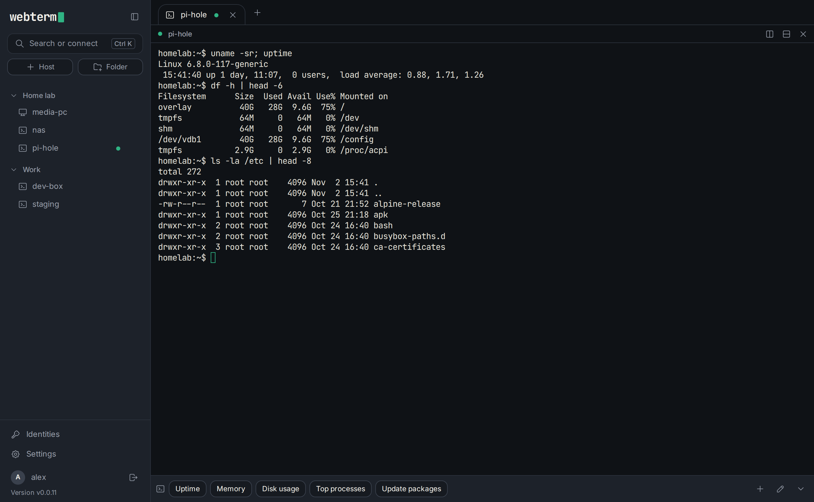
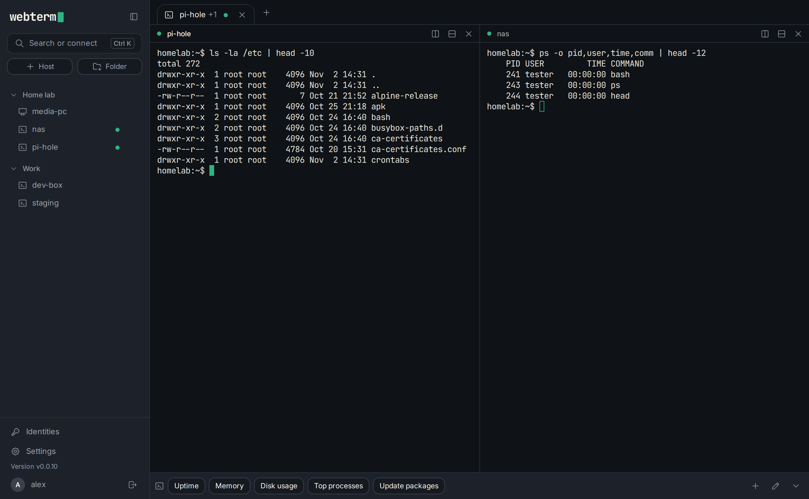
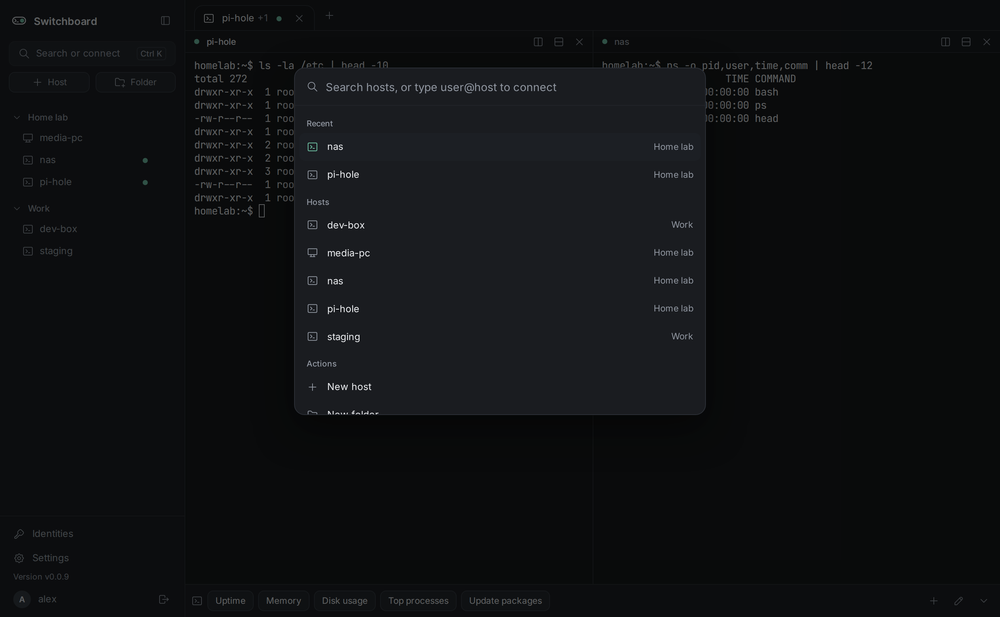
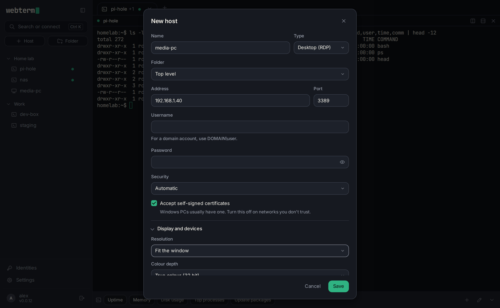
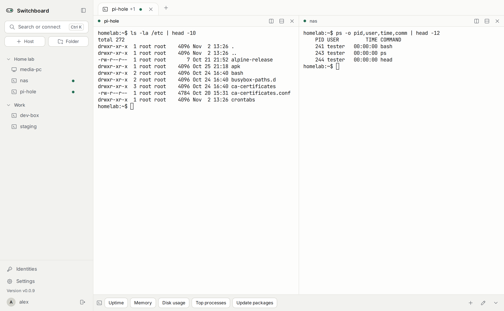
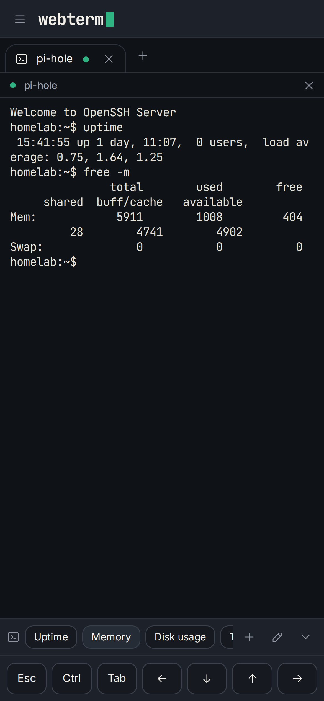

<p align="center"><picture>
  <source media="(prefers-color-scheme: dark)" srcset="cmd/webterm/web/logo-dark.svg">
  
</picture></p>

<h3 align="center">WebTerm: the self-hosted web terminal</h3>

A browser-based SSH and RDP client that runs in Docker, with one-click SSH identities and per-user encrypted vaults.
One container, one volume, one port.

Open terminals and remote desktops in tabs and split panes, from any device, with your passwords and keys
kept encrypted on a server you control.



> **This project is vibe coded.** WebTerm was written almost entirely by an AI (Claude, through Claude
> Code), with me directing, testing and reviewing it. I'm telling you up front because this software holds
> your SSH keys and server passwords, and you should decide how much to trust it with that. The
> [security section](#how-security-works) says exactly what it does, and what it doesn't.

## Screenshots

<table>
<tr>
<td width="50%"><br><sub>Split panes: terminals and desktops side by side</sub></td>
<td width="50%"><br><sub>Ctrl+K search finds any host or action</sub></td>
</tr>
<tr>
<td width="50%"><br><sub>Remote desktops, with per-host display settings</sub></td>
<td width="50%"><br><sub>Light and dark themes</sub></td>
</tr>
</table>

<p align="center"><br><sub>On a phone, with a key row for Esc, Ctrl, Tab and the arrows</sub></p>

## Run

```
docker compose up -d
```

Open `http://<server-ip>:3000`. The first visit creates the owner account. Everything is stored in the
`webterm-data` volume. For HTTPS (recommended, and needed for installing it as an app), put a reverse
proxy in front: see [HTTPS and reverse proxies](docs/guide.md#https-and-reverse-proxies).

## What it does

- **SSH terminals** with nested host folders, saved passwords or SSH keys, automatic reconnect, and Ctrl+K search.
- **Remote desktops (RDP)** in the same tabs, with clipboard, file transfer, audio and per-host display settings.
- **Split panes**: up to six sessions side by side in one tab.
- **Saved commands**: a bar under each terminal with commands you use often.
- **Proxmox**: list your VMs and containers, start, shut down and reboot them, and link a host to its VM so opening it can start the VM first.
- **Key management**: generate or import SSH keys, and push a public key to many hosts at once.
- **Tailscale built in**: each user can join their own tailnet from Settings, then reach hosts by tailnet name or IP.
- **Several users**, each with their own encrypted vault, optional two-factor sign-in, and recovery key.
- **Works on a phone**, installs as an app over HTTPS, and aims for WCAG 2.2 AA accessibility.

The details are in the [guide](docs/guide.md).

## How security works

This is what WebTerm does to protect what you store in it.

**Your secrets are encrypted twice.**
- Every user has a random vault key. Passwords and private keys are encrypted with it (XChaCha20-Poly1305),
  and the vault key itself is locked by a key derived from your account password with Argon2id.
- A master key, generated on first start and never supplied by a person, wraps everything again as an outer
  layer. Back it up from Settings (it asks for your password); without it nothing can be decrypted.
- Account passwords are stored only as Argon2id hashes. Each encrypted record is bound to its own ID, so
  records can't be swapped for one another.

**Secrets stay on the server.**
- Saved passwords and keys are decrypted only while connecting, and are never sent to your browser.
  Viewing a saved password or exporting a private key asks for your account password again.
- Saved commands and Proxmox API tokens are encrypted the same way, per user.
- WebTerm only talks to a Proxmox server that presents the exact certificate you checked and pinned when you added it, and says so if it ever changes.

**Sign-in and sessions.**
- Sessions use 256-bit random tokens in `HttpOnly`, `SameSite=Strict` cookies (also `Secure` behind HTTPS),
  kept in server memory only, with an idle timeout. Restarting the server signs everyone out.
- Sign-in, two-factor and password checks are rate limited, compare in constant time, and do the same work for
  unknown usernames. Two-factor (TOTP) codes work once and there are backup codes. An admin can require it.

**Connections.**
- SSH host keys are trusted on first use. If a key later changes, the connection stops with a warning until
  you accept it. WebTerm never skips host key checks.
- The RDP gateway (`guacd`) listens on the container's loopback only and runs as an unprivileged user.
- Each user's Tailscale connection is their own, and is used only for their own hosts.

**The web app.**
- A strict content security policy, no framing, JSON-only writes, WebSocket origin checks, and no third-party
  scripts: the few libraries it ships are vendored, and a test fails if any of them changes.

**The build.**
- Go tests, a browser walkthrough of every screen, an accessibility scan (axe-core) and `govulncheck` run on every push.
- GitHub Actions are pinned to commit hashes and base images to digests, and Dependabot proposes updates weekly.
- The dependencies are few and well known: `golang.org/x/crypto`, `modernc.org/sqlite`, `coder/websocket`,
  `tailscale.com`, and the Apache Guacamole proxy and client.

**What it doesn't do.**
- It has had **no independent security audit or penetration test.** Everything above is described by its own author,
  an AI, and checked only by its own tests.
- While you are signed in, your vault key sits in the server's memory, so anyone who controls the running server
  can use your sessions. Run it on a machine you trust.
- Out of the box it speaks plain HTTP. Put it behind HTTPS before exposing it beyond your own network.
- The master key lives in the same volume as the database unless you [move it](docs/guide.md#master-key).

Found a problem? Please open an issue, or contact me privately for anything sensitive.

## Configuration

Everything has a working default. These are optional:

| Variable | Default | |
|---|---|---|
| `WEBTERM_PORT` | `3000` | listen port inside the container |
| `WEBTERM_SESSION_TIMEOUT` | `30m` | idle timeout |
| `WEBTERM_TRUST_PROXY` | off | set to `true` behind a reverse proxy, so login rate limits count each visitor, not the proxy |
| `WEBTERM_MAX_RDP` | `10` | most remote desktops open at once |
| `WEBTERM_KEYS_DIR` | `/data/keys` | where the master key lives |
| `WEBTERM_TRANSFER_DIR` | `/tmp/webterm-transfer` | scratch space for desktop file transfer |
| `WEBTERM_GUACD` | built in | `host:port` of a guacd elsewhere, instead of the bundled one |

## More

- [Upgrading from Switchboard](docs/guide.md#upgrading-from-switchboard): WebTerm used to be called Switchboard
- [Guide](docs/guide.md): SSH keys, remote desktops, saved commands, Tailscale, HTTPS, installing as an app, the master key
- [Design system](docs/design-system.md), and `/design.html` on a running instance for the style guide
- Multi-arch (amd64, arm64) images are published to `ghcr.io/thatguy-za/webterm`: `edge` for every push to `main`, and `latest` plus version tags for every `v*` release
